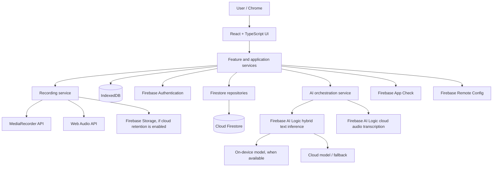

# Voca — System Architecture

**Version:** 1.0  
**Architecture style:** Modular frontend + Firebase managed backend + explicit AI orchestration.

## 1. High-level architecture



## 2. Architectural boundaries

### Presentation
React routes, screens, design-system components and interaction state. Presentation must not contain Firebase SDK calls, prompt construction, audio algorithms or direct database queries.

### Domain
Typed entities, validation schemas, scoring rubrics, metric calculations, challenge-selection rules and assessment aggregation. Domain code should be testable without Firebase or browser UI.

### Application services
Orchestrate use cases: create session, save recording, submit analysis, calculate metrics, request coaching, complete challenge and update progress.

### Infrastructure
Firebase Auth, Firestore, Storage, App Check, Remote Config, Firebase AI Logic, IndexedDB and browser media APIs. Infrastructure implements interfaces consumed by application services.

## 3. Core data flow

1. Create a session record with status `recording`.
2. Capture audio in the browser.
3. Save a local recording reference in IndexedDB.
4. Calculate local signal features from decoded audio.
5. If the user submits for transcription, upload/send audio through the selected Firebase AI Logic cloud audio route. Do not silently retain the raw file longer than necessary.
6. Validate transcript response.
7. Calculate transcript metrics such as word count, speaking rate and filler count.
8. Build a minimal coaching input from transcript, supported metrics, user goals and relevant prior weaknesses.
9. Run Firebase AI Logic hybrid inference for supported text coaching.
10. Capture actual inference source and model metadata from the SDK response.
11. Validate model output with Zod.
12. Persist assessment and session status in Firestore.
13. Update skill aggregates and recommend the next challenge.
14. Delete temporary cloud audio objects according to the retention policy.

## 4. Hybrid inference routing

Separate task selection from inference execution.

- `transcribeAudio`: cloud path, because web on-device Gemini Nano text capability must not be misrepresented as audio transcription.
- `generateCoaching`: hybrid path for transcript/metrics text.
- `generateExercise`: hybrid path for text prompt and user skill context.
- `summariseProgress`: hybrid path only if useful and supported; otherwise deterministic summaries are preferred.

Use Firebase AI Logic's documented hybrid configuration and response metadata. Capture the actual inference source returned by the SDK. A requested preference such as prefer-on-device is not proof of local execution.

The application must support:
- device does not support the local model;
- model not downloaded or not ready;
- model initialisation failure;
- user declines/does not initiate model setup;
- local inference fails;
- cloud fallback succeeds;
- cloud quota/network failure;
- malformed or schema-invalid model response.

Never make core recording and session history dependent on on-device model availability.

## 5. Firebase services

- Firebase Authentication: identity.
- Cloud Firestore: user profiles, goals, session metadata, assessments, skill aggregates and challenge progress.
- Firebase AI Logic: cloud and hybrid model inference.
- Firebase App Check: protect Firebase AI Logic and applicable Firebase services.
- Firebase Remote Config: controlled model/configuration and feature rollout; do not use it to store secrets.
- Firebase Storage: optional audio persistence only with explicit user consent and security rules.
- Firebase Hosting: web delivery.

Avoid introducing Cloud Functions unless there is a specific server-trusted operation. If later needed, use them for trusted cleanup, scheduled aggregation or operations that must not run in an untrusted client.

## 6. Firestore collection model

```text
users/{uid}
  profile fields, goals, preferences, createdAt, updatedAt

users/{uid}/sessions/{sessionId}
  title, category, promptId, durationSeconds, status,
  recordingStoragePath?, transcriptStatus, createdAt, completedAt

users/{uid}/assessments/{assessmentId}
  sessionId, transcript?, metrics, skills, feedback,
  inferenceMetadata, createdAt

users/{uid}/skillSnapshots/{snapshotId}
  scores, evidenceCount, confidence/coverage, createdAt

users/{uid}/challengeProgress/{progressId}
  challengeId, status, assignedAt, completedAt

challengeCatalog/{challengeId}
  title, category, instructions, targetSkill, durationSeconds,
  difficulty, active
```

Prefer user-scoped subcollections for private user records. Public challenge catalogue documents must contain no user-specific information.

## 7. Security and privacy

- Firestore rules: authenticated user can read/write only their own user document and subcollections.
- Validate ownership and allowed fields in rules; never rely only on frontend filtering.
- Storage rules: user can access only their own audio objects, with content type and size restrictions.
- App Check enabled for supported Firebase services and AI Logic.
- No service account credentials or privileged API keys in browser bundles.
- No raw audio/transcript in analytics, console logs or crash reports.
- Explicit consent before uploading or retaining recordings.
- Provide delete-session and delete-account data lifecycle.
- Keep only the minimum transcript/audio necessary for the feature and user-selected retention.

## 8. Reliability and observability

Capture operational metadata only:
- operation name;
- request/correlation ID;
- inference source;
- model identifier;
- latency;
- status/error category;
- fallback reason.

Do not log prompts containing raw personal content or full model responses. User-facing errors should explain next steps without exposing provider internals.

## 9. Deployment topology

- Vite build hosted on Firebase Hosting.
- Firebase project environments: local emulator/development and production.
- Separate Firebase projects for development and production if practical.
- `.env.example` contains only public Firebase web configuration placeholders.
- Security rules and indexes are version-controlled.
- CI runs typecheck, tests and production build.
